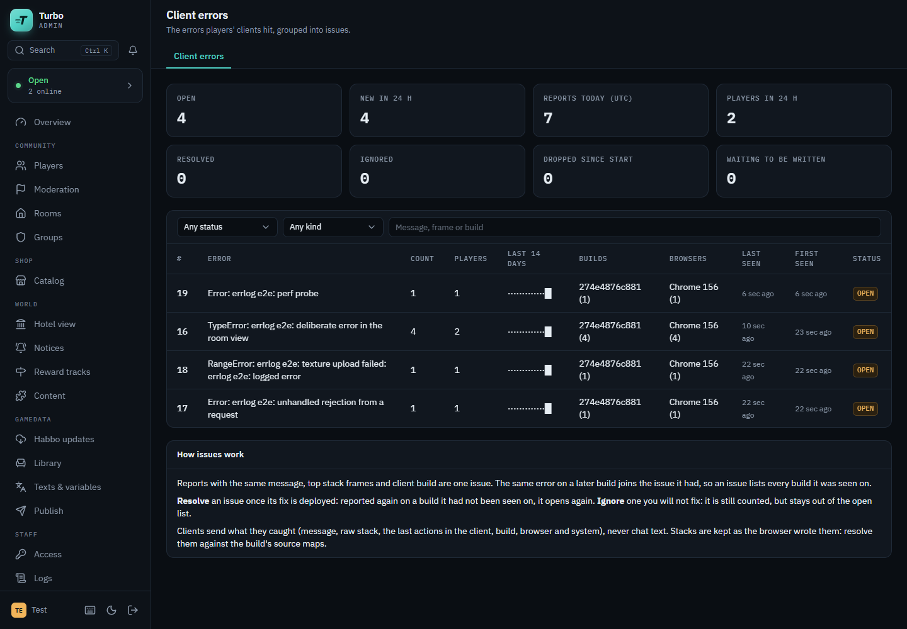
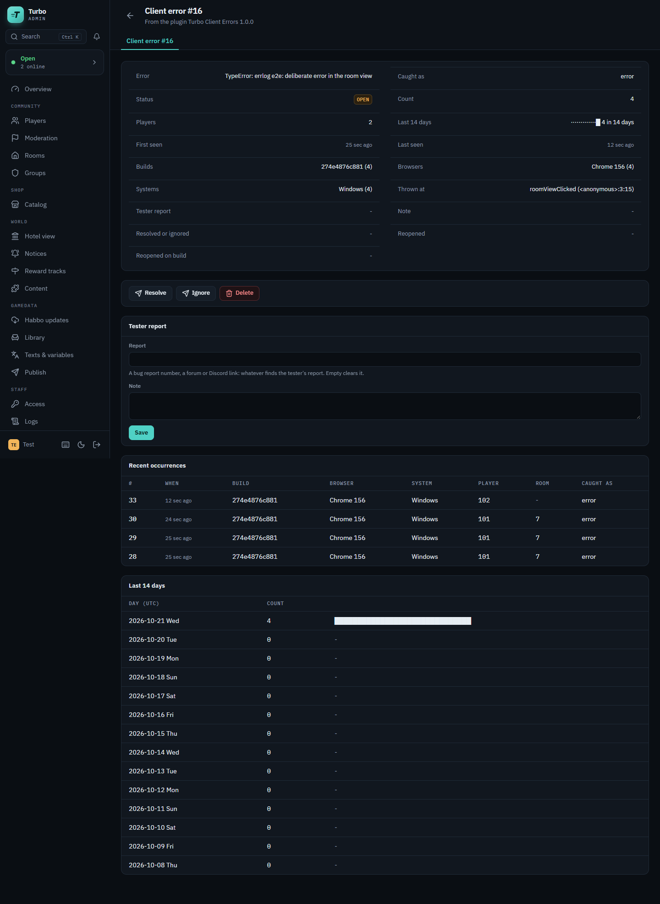
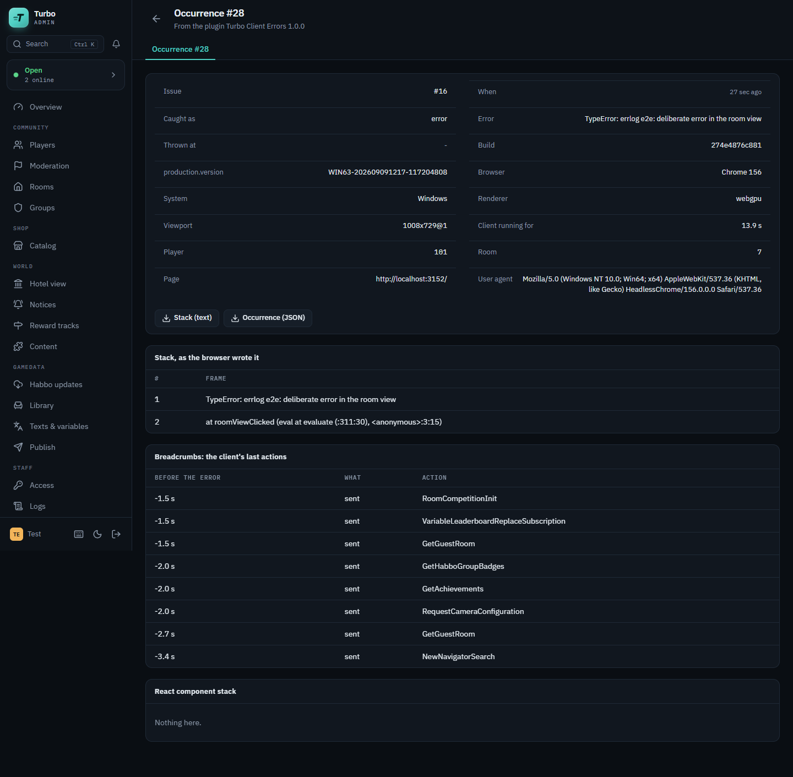

# Turbo Client Errors plugin

The errors players' clients hit, for a [Turbo](https://github.com/nitrodevco/turbo-cloud) hotel,
grouped into issues on the admin panel's **Client errors** page: what was thrown, how often, by how
many players, on which builds, browsers and systems, and what the client did just before.

- Reports with the same message, top stack frames and client build are one **issue**. The same
  error on a later build joins the issue it had, so an issue lists every build it was seen on.
- **Resolve** an issue once its fix is deployed: reported again on a build it had not been seen on,
  it opens again. **Ignore** one you will not fix: it is still counted, but stays out of the open
  list. Link an issue to the tester report it belongs to (a number or a link) with a note.
- Each issue keeps its counts in full, a day-by-day trend and its latest occurrences whole: the
  raw stack, React's component stack, the last messages the client sent (by name only) and the
  client's build, browser, system, renderer, viewport, room and player.
- Each new issue, and each resolved one that comes back, is told to other plugins as a plugin
  notice: with the [Turbo Discord plugin](https://github.com/Diddyy/turbo-discord-plugin) loaded it
  is posted to Discord like any other hotel event. Without it, the plugin can post new issues to a
  webhook of its own.



## The `clienterrors` extension (version 1)

A client opts in by asking for the `clienterrors` capability (Turbo's `docs/client-capabilities.md`).
The server offers it while the plugin is loaded and `Enabled` is on. A client the server did not
accept it from sends nothing, records nothing and listens to nothing; a report from a session that
did not accept it is dropped.

| Direction | Header | Body |
| --- | --- | --- |
| client to server | 21100 | `int length` + one report as UTF-8 JSON |

The report (every field but `message` or `name` may be left out; unknown fields are ignored, texts
are cut to their column):

| Field | |
| --- | --- |
| `kind` | `error` (uncaught), `rejection` (unhandled promise rejection), `react` (an error boundary), `renderer` (the GPU lost), `logged` (an error the client caught and logged) |
| `name`, `message` | The error's name and message. |
| `stack` | The stack as the browser wrote it: resolve it against the build's source maps. |
| `componentStack` | React's component stack, for `react`. |
| `source` | `file:line:column`, when the browser gave no stack. |
| `build` | The client build (its commit, or what the host named it). Part of the fingerprint. |
| `production` | The client's `production.version`. |
| `userAgent`, `platform` | The browser; the browser and system are derived from them. |
| `page` | The page the client ran on. The server keeps it without its query and fragment (a login ticket is never stored). |
| `roomId` | The room the player was in. |
| `viewport` | `{ width, height, pixelRatio }`. |
| `renderer` | `webgl` or `webgpu`. |
| `uptimeMs` | How long the client had been running. |
| `breadcrumbs` | `[{ t, c, m }]`: milliseconds since start, a category and what happened, oldest first. The last 30 are kept. |

nitro-next speaks it (`packages/nitro-react/src/context/clienterrors`): `window` `error` and
`unhandledrejection`, its view error boundary, `NitroLogger.error` (the renderer's and the UI's
caught errors) and a lost GPU, with the names of the last 20 messages it sent as breadcrumbs. It
holds itself to the same limits as the server.

## Limits

Everything a session sends is checked in memory before anything else happens: the plugin is on,
the report is not empty or larger than `MaxPayloadBytes`, the session is within
`ReportsPerMinute` and `MaxReportsPerSession`, and it accepted the extension. A report that passes
is queued (at most `QueueCapacity`) and written in batches by one background loop; the session
never waits for the database. A full queue drops at once. Drops are counted on the page's tiles.

## Settings

Under `Turbo:ClientErrors` in the server's configuration (`appsettings.json`, the environment:
`Turbo__ClientErrors__DiscordWebhookUrl=...`, or the admin panel's Settings page while the plugin
is loaded). A change applies at once.

| Setting | Default | |
| --- | --- | --- |
| `Enabled` | true | Whether clients are offered the extension. Off: no client that logs in afterwards reports anything, and reports from sessions that accepted it earlier are dropped. |
| `MaxPayloadBytes` | 32768 | The largest report taken, in bytes of JSON. |
| `ReportsPerMinute` | 10 | How many reports one session may send per minute (a burst of as many is allowed). |
| `MaxReportsPerSession` | 100 | How many reports one session may send in all. |
| `QueueCapacity` | 2000 | How many reports wait for the database at most. |
| `FingerprintFrames` | 5 | How many of the top stack frames tell two errors apart (with the message and the build). |
| `MaxStackLength` | 16000 | The longest stack kept, in characters. |
| `MaxOccurrencesPerIssue` | 50 | How many of an issue's latest occurrences are kept whole; counts are kept in full. |
| `OccurrenceRetentionDays` | 30 | How long an occurrence is kept. |
| `IssueRetentionDays` | 90 | How long an issue no client has reported is kept, with its counts and trend. 0: for ever. |
| `DiscordWebhookUrl` | empty | A Discord webhook each new issue is posted to. Empty: none. A secret: the panel never shows it. For a hotel without the Discord plugin, which is the preferred way (Notices, below). |
| `DiscordMaxPerHour` | 10 | The most new issues posted in an hour; the rest are counted in the next post. |

When the server has `Turbo:Admin:PanelUrl`, a Discord post links to the issue's page.

## Notices (Discord)

From version 1.1.0 the plugin publishes a `PluginNoticeEvent` (turbo-cloud's
`docs/plugin-notices.md`, turbo-cloud #296 or later) on the hotel's event system, once the issue is
stored:

| Topic | When | Key | Level |
| --- | --- | --- | --- |
| `issue.new` | A fingerprint is a new issue. | the issue id | Error |
| `issue.reopened` | A resolved issue is reported on a build it had not been seen on. | `<issue id>@<build>` | Warning |

Each carries the message and top stack frames, the fields Kind, Build, Players and Count, and a
link to the issue's page when the server has `Turbo:Admin:PanelUrl`. A reopened notice is keyed by
its build as well, so an issue that comes back again on a later build is told again.

The [Turbo Discord plugin](https://github.com/Diddyy/turbo-discord-plugin) is the preferred way to
get these into Discord: it lists `plugin:clienterrors:issue.new` and
`plugin:clienterrors:issue.reopened` in its routing table (off until the hotel turns them on and
gives them a webhook), posts each once, and paces and queues its posts across restarts.
`DiscordWebhookUrl` still works for a hotel without it; leave it empty when the Discord plugin is
routing these, or new issues are posted twice. With no relay loaded a notice goes nowhere, and a
notice that cannot be published is logged: the issue is stored either way.

## Permissions

Declared by the plugin (Access in the admin panel lists them while it is loaded); no group holds
them until the hotel grants them, or holds `*`:

| Node | |
| --- | --- |
| `plugin.clienterrors.issues.view` | See the Client errors pages. |
| `plugin.clienterrors.issues.manage` | Resolve, ignore and reopen issues, and link them to a tester report. |
| `plugin.clienterrors.issues.delete` | Delete an issue with its counts, trend and occurrences. |

## Privacy

Clients send what they caught and the names of the messages they sent, never a message's content,
so never chat text. The page is stored without its query. Player ids are kept per occurrence and
per issue (to count affected players) and go with the issue under the retention settings. No IP
address is stored.

## Tables

`clienterrors_issues`, `clienterrors_fingerprints`, `clienterrors_facets` (builds, browsers,
systems and players per issue), `clienterrors_issue_days` (the trend) and
`clienterrors_occurrences`. Retention runs a minute after start and then hourly. Uninstalling the
plugin from the panel drops them.

## Build and install

The plugin is its sources: a Turbo server compiles `server/**/*.cs` as it loads the plugin
(turbo-cloud `docs/plugin-loading.md`), and its folder holds nothing built.
`server/TurboClientErrors.csproj` imports what the server compiles plugins with
(`plugin-sdk/Turbo.Plugin.props` beside the server's assemblies: the same references, C# and
policy), so building it is the server's check:

```sh
TurboBin=/path/to/turbo-cloud/Turbo.Main/bin/Debug/net10.0 dotnet build server/TurboClientErrors.csproj
TurboBin=/path/to/turbo-cloud/Turbo.Main/bin/Debug/net10.0 ./scripts/package.sh
```

`TurboBin` is the bin folder of the server to build against (by default `../turbo-cloud`'s built
`Turbo.Main`). `package.sh` checks the sources compile, then leaves `dist/clienterrors/` with
`manifest.json` and `server/`. Copy that folder into the server's plugin folder
(`Turbo:Plugin:PluginFolderPath`, by default `plugins/` beside `Turbo.Main`), as
`plugins/clienterrors/` (or zip it and install it from the admin panel: Plugins, Install), and
restart the server (or let hot reload pick it up). On load the plugin creates its tables through the
server's own migrator, so the server's `Turbo:Database:Migrate` setting applies to them as to core's
tables.

### Releases

A server linked to this repository in the admin panel (Plugins, Link from GitHub) installs the
sources of its newest release's tag, GitHub's source archive: there is no built asset. Set the
manifest's `Version` (1.2.3), then push the tag `v1.2.3` (or name it in a manual run of Release,
which makes it on that commit): `.github/workflows/release.yml` checks the tag matches the manifest,
checks and tests the plugin against turbo-cloud's `main` and makes the release. `ApiVersion` in the
manifest is the turbo-cloud plugin API it is written for (`Turbo.Contracts.Plugins.PluginApi`).

## Tests

```sh
TurboBin=/path/to/turbo-cloud/Turbo.Main/bin/Debug/net10.0 dotnet test tests/TurboClientErrors.Tests
dotnet tool restore && dotnet csharpier check .
```

`.github/workflows/ci.yml` runs both on every push and pull request against turbo-cloud's `main`.

## Migrations

```sh
TurboBin=/path/to/turbo-cloud/Turbo.Main/bin/Debug/net10.0 DesignTime=true dotnet ef migrations add <Name> \
  --project server/TurboClientErrors.csproj --context ClientErrorsDbContext --output-dir Database/Migrations
```

## Screens

| | |
| --- | --- |
|  |  |
| An issue: counts, trend, builds, browsers, systems, the tester report, its occurrences. | An occurrence: the raw stack and the client's last actions. |
